# Finora AI (FinChat) — Master Implementation Plan (Frozen & Patched Specification)

## Executive Summary

This Master Implementation Plan is the **frozen, fully patched technical specification** for the Finora AI (FinChat) production prototype. It incorporates all operating rules (including the new Rule A.8 Conflict Hold), decisions D1–D8, restored failure modes B.1–B.9, dependency alignments, and the updated 19-package sequence.

The system is built on Azure Functions v4 (Node.js 22), Azure SQL Database, Azure AI Search, Azure Blob Storage, and Azure OpenAI. All numbers derive strictly from SQL facts and decimal calculations; all conflicts require human authority (zero auto-resolution).

---

## 1. Operating Rules & Core Decisions

### Section A: Invariable Operating Rules
- **A.1 Human Authority**: Conflicts are ALWAYS decided by a human. Never auto-resolve by authority rank, recency, or value. Ranks are display-only.
- **A.2 Uploader Decision**: The conflict email goes to the DOCUMENT UPLOADER with both conflicting files. The uploader chooses which file to keep and which to delete.
- **A.3 Soft Delete**: Delete = soft delete: remove from answers and Azure AI Search, keep SQL rows for audit, never touch the SharePoint file or Blob storage file.
- **A.4 Zero Data Leaks**: Only approved facts may ever reach chat answers, calculations, or search indexes. Pending, Rejected, Superseded, NeedsReview, and NULL-status facts must never leak.
- **A.5 Deterministic Arithmetic**: Numbers come from SQL and code (via a decimal library), never from LLM arithmetic. RAG is for narrative text only.
- **A.6 Strict Scope**: Scope is PDF and Excel (.xlsx, .xls) IFRS and HR reports only. Arabic and English must both work. Scanned PDFs without a usable text layer, encrypted files, macro-enabled workbooks (.xlsm), Word, CSV, images, and JSON payloads are rejected upfront.
- **A.7 Phase 2 Boundary**: Authentication, document-level authorization, and authority verification are deferred to Phase 2. They are demarcated with `ENFORCE_AUTH=false`, `TODO(PHASE2)` code markers, and documented in `KNOWN_LIMITATIONS.md`.
- **A.8 Conflict Hold**: While a conflict is open, the system gives **NO answer** about either conflicted file (incoming AND existing, whole file). It returns `status: 'CONFLICT_PENDING'` (HTTP 409) naming both files in user's language with **no figures quoted**. Answers resume only after a human decision is applied. Never quote or compute with held values; never give a "most likely" answer.

### Section B: Architectural Decisions (D1 to D8)
- **D1. HTTP Uploader Email**: Extracted from `x-user-email` header; checked against `ALLOWED_UPLOADER_EMAIL_DOMAINS` config; other domains fall back to `FINCHAT_ADMIN_EMAIL`. Marked unverified in `KNOWN_LIMITATIONS.md`.
- **D2. File-Level Decisions**: Decisions are FILE-LEVEL. Non-conflicting facts of the incoming file stay `Pending` and follow the file decision. "Keep incoming" supersedes ALL facts of the existing file, including ones that never conflicted. Documented in `KNOWN_LIMITATIONS.md`.
- **D3. Email Delivery Channel**: Microsoft Graph `sendMail` from a shared mailbox (`CONFLICT_MAILBOX_SENDER`). No SMTP. Application Access Policy and `Mail.Send` consent are labeled `UNVERIFIED – needs live check`.
- **D4. Conflict Tolerance**: Absolute difference $\le 0.001$ OR percentage difference $\le 0.01\%$. Kept in a single configuration constant (`FINCHAT_CONFLICT_ABS_TOLERANCE`, `FINCHAT_CONFLICT_PCT_TOLERANCE`).
- **D5. PartiallyApproved Narrative Hold**: For `PartiallyApproved` documents, chat answers ONLY approved SQL facts. Narrative RAG chunks of `PartiallyApproved` documents are NOT searchable.
- **D6. Multilingual Embedding Model**: Standardized on `text-embedding-3-small` (1536 dimensions) everywhere (code, docs, diagrams, tests).
- **D7. Search Allow-List Exclusion**: Search exclusion uses a strict runtime ALLOW-LIST: chat queries SQL for allowed document IDs (`IngestionStatus = 'Succeeded' AND IndexingStatus = 'Indexed' AND ConflictHold = 0`) and applies them as a filter.
- **D8. Pure Environment-Driven Model Deployments**: Model deployment names come exclusively from environment variables (`AZURE_OPENAI_FAST_DEPLOYMENT`, `AZURE_OPENAI_STRONG_DEPLOYMENT`). No hardcoded model defaults in code or docs.

### Section C: Known Failure Modes & Self-Check Checklist (B.1 to B.9)
Every package must self-check against each item in its completion report:
- **B.1 Silent Assumptions**: If a requirement is ambiguous, stop and ask. Do not invent.
- **B.2 Scope Creep & Drift**: Build only what the current work package asks. Do not refactor unrelated code.
- **B.3 Done Without Proof**: Never claim a package is done unless all tests run, pass, and real output is shown.
- **B.4 Fake or Weakened Tests**: Never mock the logic under test, delete tests, or loosen assertions.
- **B.5 Hard Parts Included**: Implement per-pair locking (`sp_getapplock`), outbox retry, SHA-256 idempotency, soft-delete cascade, and Arabic digit normalization.
- **B.6 Data Leaks**: Verify no query reads unapproved facts and no chunk of a non-approved or held document is searchable.
- **B.7 Partial State**: Every multi-step transition must be atomic in SQL or have a retry/reconciliation path.
- **B.8 Unverified Items**: Label real cloud dependencies as `UNVERIFIED – needs live check` with concrete manual steps.
- **B.9 Seeded Edge Cases**:
  1. Uploader email bounce/missing $\to$ admin escalation path.
  2. File conflicting with an earlier version of itself.
  3. Partial conflict: non-conflicting facts preserved as `Pending` until file decision.
  4. Two incoming files conflicting with each other (`sp_getapplock` serialization).
  5. One incoming file conflicting with multiple existing files (pair grouping + `Moot` cascade).
  6. Expired token, replayed token, double submit (409 Conflict).
  7. SQL succeeds but Search fails, and reverse (reconciler repairs).
  8. Function restart mid-ingestion recovery (durable queue idempotency).
  9. Duplicate file uploaded twice (SHA-256 `ContentHash` idempotency).
  10. Cross-lingual QA (Arabic question $\leftrightarrow$ English document).

---

## 2. Frozen Package Execution Sequence (Dependency Patched)

```mermaid
flowchart TD
    WP1["1. WP1: Traceability & Phase 2 Stubs"] --> WP13["2. WP13: Fact Integrity & Master Schema Migration"]
    WP13 --> WP2["3. WP2: Scope, Scanned PDF & ContentHash"]
    WP2 --> WP3["4. WP3: Pure SQL Facts & Decimal Math Engine"]
    WP3 --> WP6["5. WP6: Conflict Detection & Pair Sequencing"]
    WP6 --> WP14["6. WP14: Blob Storage & SAS Generation"]
    WP14 --> WP8["7. WP8: Cryptographic Decision Tokens"]
    WP8 --> WP7["8. WP7: Uploader Conflict Email (Dual Links)"]
    WP7 --> WP16["9. WP16: Conflict Lifecycle & Reminders"]
    WP16 --> WP15["10. WP15: Durable Ingestion Pipeline"]
    WP15 --> WP9["11. WP9: Soft Delete & Search Reconciler"]
    WP9 --> WP10["12. WP10: Leak Prevention & Search Allow-List"]
    WP10 --> WP17["13. WP17: Chat Conflict Notice & Refusals"]
    WP17 --> WP4["14. WP4: Pure Azure Multi-Model Router"]
    WP4 --> WP5["15. WP5: Multilingual Embeddings & Arabic Norm"]
    WP5 --> WP11["16. WP11: SharePoint Monthly Scan & Rate Limiting"]
    WP11 --> WP18["17. WP18: Observability, Admin View & Backlog"]
    WP18 --> WP12["18. WP12: Acceptance Suite & Fixture Runner"]
    WP12 --> WP19["19. WP19: Final Gate Verification"]
```

---

## 3. Work Package Specifications

### WP1: Baseline Traceability & Phase 2 Guardrails
- **Deliverables**:
  - Add configuration setting `ENFORCE_AUTH=false` in `src/utils/config.js` via plain `isAuthEnforced()` reading `process.env.ENFORCE_AUTH` at call time (no `process.env` Proxy mutation).
  - Place `TODO(PHASE2)` markers at all auth/ACL points (`confirmConflict.js`, `ingestDocument.js`, `chat.js`, `sharepoint-queue.js`).
  - Preserved active `AllowedUserGroups` security check in `src/functions/chat.js` with an informational `TODO(PHASE2)` marker.
  - Create initial `REQUIREMENTS_TRACE.md` and `KNOWN_LIMITATIONS.md` (documenting that `x-user-groups` header is client-supplied and untrusted).
- **Acceptance Cases**: Append baseline configuration test case to `tests/acceptance/acceptance-dataset.json`.

---

### WP13: Fact Integrity & Master Schema Migration (Consolidated)
- **Deliverables**:
  - **Single Consolidated Migration for `dbo.Documents`**:
    - `ContentHash` NVARCHAR(64) NULL
    - `IndexingStatus` NVARCHAR(30) NOT NULL DEFAULT 'NotIndexed'
    - `UploaderEmail` NVARCHAR(255) NULL
    - `BlobUri` NVARCHAR(1000) NULL
    - `ConflictHold` BIT NOT NULL DEFAULT 0
  - **Schema Updates on `dbo.FinancialFacts`**:
    - `Unit` NVARCHAR(50) NULL, `AsOfDate` DATE NULL, `SourceLocationHash` CHAR(64) NULL, `FactIdentityHash` CHAR(64) NULL.
    - Unique filtered index `UX_FinancialFacts_Doc_Identity_Location` on `(DocumentId, FactIdentityHash, SourceLocationHash)`.
    - Strict 5-field integrity rule: missing `entity`, `period`, `unit`, `reportingBasis`, or `sourceLocation` routes fact to `MappingStatus = 'NeedsReview'`.
  - **Schema Updates on `dbo.FactConflicts`**:
    - `ReissueCount` INT NOT NULL DEFAULT 0, `NotificationRetryCount` INT NOT NULL DEFAULT 0, `NotificationError` NVARCHAR(MAX) NULL, `TokenExpiresAt` DATETIME2 NULL.
    - Status domain: `'PendingApproval'`, `'PendingReview'`, `'Detected'`, `'Potential'`, `'Resolved'`, `'Rejected'`, `'Escalated'`, `'Moot'`.
  - **Documents Hold As Derived State**:
    - `ConflictHold` and `OpenConflictId` on `dbo.Documents` are cached state columns, recomputed dynamically by WP6/WP9 from open conflicts.
  - **EntityAliases & MetricAliases**: Create `dbo.EntityAliases` and seed IFRS/HR terms in English and Arabic.
  - **Per-Entity Fiscal Year**: Add `FiscalYearStartMonth` config per entity.
  - **Backfill Migration**: Backfill historical rows: `NULL` mapping status $\to$ `NeedsReview`, `IndexingStatus = 'NotIndexed'`, `ConflictHold = 0`, compute `ContentHash` where possible.
- **Acceptance Cases**: Append missing field $\to$ `NeedsReview` and duplicate rejection cases to `acceptance-dataset.json`.

---

### WP2: Ingestion Scope, Scanned PDF Detection & ContentHash Idempotency
- **Deliverables**:
  - **Route-Level Rejection**: Hard-reject CSV, plain text, markdown, and JSON payloads at route level in `ingestDocument.js`.
  - **Security & Feature Rejections**: Reject encrypted files, macro workbooks (.xlsm), external links, and oversize files with clear notice (email for SharePoint, API error for HTTP).
  - **Hidden Content Tagging**: Extract hidden sheets/rows/columns but tag them; facts from hidden content route to `NeedsReview`.
  - **Scanned PDF Detection**: Check text density; if $< 100$ characters without an embedded text layer, fail with `ScannedPdfNotSupported`.
  - **ContentHash Idempotency**: SHA-256 `ContentHash`. Re-uploading identical content for `Succeeded` or in-progress documents returns existing ID. Failed/Rejected files may be re-uploaded.
  - **Prompt Injection Guard**: Document text is treated as untrusted data, enclosed in delimiters with instructions to ignore internal commands. Test with prompt-injected document.
- **Acceptance Cases**: Append scope rejection, scanned PDF, idempotency, and prompt-injection cases to `acceptance-dataset.json`.

---

### WP3: Pure SQL Fact Store, Effective Facts & Decimal Math Engine
- **Deliverables**:
  - **SQL View Rewrite**: Recreate `dbo.vw_FinancialFacts_Complete` joining `dbo.Documents d` with:
    `WHERE f.MappingStatus = 'Approved' AND d.ConflictHold = 0`. Explicitly remove `OR MappingStatus IS NULL`.
  - **One Effective Fact Rule**: If two Approved facts share an identity (e.g. v2 repeats v1 within tolerance), select the fact from the latest non-superseded document version. Sums and reconciliations de-duplicate by identity.
  - **Question-to-Fact Resolution**: Pre-SQL translation mapping natural language $\to$ canonical dimensions. Deterministic parser for Arabic and relative periods ("Q1", "الربع الأول", "last year"). If ambiguous, return `status: 'NEEDS_CLARIFICATION'`.
  - **Decimal Math Library**: Integrate `decimal.js` or `big.js` in `calculation-engine.js`. Enforce all 7 calculation rules (zero-base returns null + reason, variance direction, missing period string, no currency mixing, half-up 2 dp).
  - **Structured Provenance Format**: Answers state: value, unit, currency, scale, reporting basis, as-of date, file name, sheet/page, cell location.
  - **Prompt Directive**: Forbid LLM from altering or computing numbers.
- **Acceptance Cases**: Append decimal calculation, zero-base, clarification, and provenance format cases to `acceptance-dataset.json`.

---

### WP6: Conflict Detection Engine, AppLock & Pair Sequencing
- **Deliverables**:
  - **8-Field Identity**: `(Metric, Entity, Period, Basis, Scope, Unit, Currency, Dimensions)`. Entity resolved via `EntityAliases`.
  - **D4 Tolerance**: Mismatch triggers conflict only if absolute diff $> 0.001$ AND percentage diff $> 0.01\%$.
  - **Simultaneous Detection & AppLock**: Detect against both `Approved` AND `Pending` facts. Serialize detection per identity hash using `sp_getapplock` inside the transaction.
  - **Multi-Conflict Document Hold**: Set `ConflictHold = 1` on BOTH documents in the pair. Hold is active while `EXISTS` any open conflict for that document.
  - **Pair Sequencing & Moot Cascade**: Group conflicts per `(incomingDoc, existingDoc)` pair. If uploader keeps existing file in any pair, incoming file is `Rejected` and remaining pairs close as `Moot`.
  - **Self-Version Conflicts**: Conflicts against an earlier version of the same logical document require human decision; never auto-supersede.
- **Acceptance Cases**: Append tolerance boundary, multi-file Moot, and self-version conflict cases to `acceptance-dataset.json`.

---

### WP14: HTTP Upload Blob Storage & SAS Generation (Moved Up)
- **Deliverables**:
  - Stream HTTP uploads into Azure Blob Storage container (`AZURE_STORAGE_CONTAINER_UPLOADS`). Save `BlobUri` on `dbo.Documents`.
  - Implement time-limited (72h) read-only Shared Access Signature (SAS) generation utility (`generateBlobSasUrl`).
  - Soft delete never deletes the blob or SharePoint file. Mark SAS/Blob network access as `UNVERIFIED – needs live check`.
- **Acceptance Cases**: Append Blob persistence and SAS generation test cases to `acceptance-dataset.json`.

---

### WP8: Cryptographic Decision Tokens & Safe HTTP Endpoints
- **Deliverables**:
  - **HMAC Decision Tokens**: Issue HMAC-SHA256 tokens with 72-hour validity; store `DecisionTokenHash` in `dbo.FactConflicts`.
  - **RFC 7231 Safe Methods**: `GET /api/confirmConflict` is strictly read-only preview; state mutations strictly require `POST /api/confirmConflict`.
  - **Decision Execution Stub**: Implement `applyConflictDecision` stub to validate tokens, log decisions, and update conflict/fact status safely.
  - **Replay & Expiration**: Single-use token hash validation returning HTTP 409 on second submission; expired tokens return HTTP 410.
- **Acceptance Cases**: Append GET read-only, POST mutation, 409 replay, and 410 expiration cases to `acceptance-dataset.json`.

---

### WP7: Uploader Conflict Notification Dispatch (Dual Links)
- **Deliverables**:
  - **Recipient Resolution & Domain Check**: Extract uploader from `x-user-email` (HTTP) or `ModifiedByEmail` (SharePoint). Validate domain against `ALLOWED_UPLOADER_EMAIL_DOMAINS` config; fallback to `FINCHAT_ADMIN_EMAIL`.
  - **Email Content via Graph sendMail**: Sent from shared mailbox (`CONFLICT_MAILBOX_SENDER`). Shows both files, cell locations, and display-only authority ranks.
  - **Figures-Lost Disclosure**: Before a "keep incoming" decision is offered, email and review page list figures that would be lost.
  - **Dual Links**: Include official SharePoint Web URL and fresh read-only Blob SAS URL (from WP14), embedding cryptographic decision tokens from WP8.
- **Acceptance Cases**: Append domain validation, figures-lost formatting, and dual-link cases to `acceptance-dataset.json`.

---

### WP16: Conflict Lifecycle Completion, Reminders & Escalation
- **Deliverables**:
  - **Reminders**: Scheduled worker sends reminders at 24h and 48h for unresolved conflicts.
  - **Token Reissue & Escalation**: On 72h expiry, reissue new token up to 3 times (`FINCHAT_MAX_TOKEN_REISSUES = 3`). On 4th expiry, mark `ConflictStatus = 'Escalated'` and send decision link to `FINCHAT_ADMIN_EMAIL`.
  - **Hold Invariance**: ConflictHold NEVER releases on reminder, expiry, reissue, escalation, or email failure.
  - **Maximum Hold Days**: `CONFLICT_MAX_HOLD_DAYS` (default 14). Past 14 days, alert admin daily.
  - **Outbox Retry with Cap**: Failed emails set `NotificationStatus = 'PendingRetry'`. Max 5 retries before marking `Failed`.
- **Acceptance Cases**: Append 24h/48h reminders, 3-strike escalation, outbox retry cap, and hold persistence cases to `acceptance-dataset.json`.

---

### WP15: Durable Ingestion Pipeline (Storage Queue)
- **Deliverables**:
  - Decouple HTTP ingestion: `POST /api/ingestDocument` validates scope, uploads blob, enqueues work item to Azure Storage Queue (`ingestion-queue`), and returns HTTP 202 immediately.
  - Queue trigger worker `processIngestionQueue` processes document with ContentHash idempotency and WP13 constraints.
  - Function restart resilience: re-reading queue message safely resumes without duplicate facts.
  - Poison message handling: max dequeue count = 5; then moves to `ingestion-poison-queue` and sets document `Failed`.
- **Acceptance Cases**: Append queue trigger, restart idempotency, and poison queue cases to `acceptance-dataset.json`.

---

### WP9: Soft-Delete Cascade, IndexingStatus & Bidirectional Reconciler
- **Deliverables**:
  - **`Documents.IndexingStatus`**: `NotIndexed`, `Indexed`, `Failed`, `PendingDelete`.
  - **Soft-Delete Cascade**:
    - *Keep Existing*: Incoming facts $\to$ `Rejected`, incoming doc $\to$ `Rejected`, `IndexingStatus = 'NotIndexed'`.
    - *Keep Incoming*: Incoming facts $\to$ `Approved`, incoming doc $\to$ `Succeeded`. Existing facts $\to$ `Superseded`, existing doc $\to$ `Superseded`, existing doc `IndexingStatus = 'PendingDelete'`.
  - **Search Chunk Purge**: Delete all chunks matching superseded/rejected documents from Azure AI Search (`deleteDocumentChunks`).
  - **Hold Release**: `ConflictHold` is released strictly inside the decision transaction when zero open conflicts remain for the document.
  - **Bidirectional Reconciler**: Timer compares SQL-approved documents with Search: re-indexes missing chunks and purges orphaned chunks.
  - **SharePoint Removal During Conflict**: If file is deleted in SharePoint during an open conflict, mark conflict `Moot`, keep surviving file, release hold, log event.
- **Tests Added**: Transaction rollback; chunk purge; reconciler repair; SharePoint file removal during conflict.

---

### WP10: Leak Prevention & Search Allow-List
- **Deliverables**:
  - **D7 Dynamic Allow-List**: Chat queries SQL for allowed document IDs (`IngestionStatus = 'Succeeded' AND IndexingStatus = 'Indexed' AND ConflictHold = 0`) and applies `$filter = search.in(documentId, '...')`. Stale index fields cannot leak.
  - **D5 PartiallyApproved Hold**: Narrative chunks of `PartiallyApproved` files are not searchable; chat answers strictly from approved SQL facts.
  - **Preparation State**: After a decision, until indexing finishes, answer is `DOCUMENT_BEING_PREPARED`, never stale data.
- **Acceptance Cases**: Append leak prevention cases across all statuses (`Pending`, `Rejected`, `Superseded`, `NeedsReview`, `NULL`, `PartiallyApproved`, `ConflictHold = 1`).

---

### WP17: Chat Conflict Notice, Rule A.8 Hold & Refusals
- **Deliverables**:
  - **Rule A.8 Conflict Hold**: If a query targets a held document (by ID, file name, entity/period, or matched fact), return `status: 'CONFLICT_PENDING'` (HTTP 409) naming both files in user's language with **no figures**. Never quote held values. Multi-part questions return `CONFLICT_PENDING` if any required figure is held.
  - **Structured Statuses**: `NO_APPROVED_EVIDENCE`, `OUT_OF_SCOPE_QUESTION`, `NEEDS_CLARIFICATION`, `CONFLICT_PENDING`, `DOCUMENT_BEING_PREPARED`, `REJECTED`, `SUPERSEDED`.
  - **Independent Turns**: Each turn is evaluated independently in Phase 1; hold/leak checks apply to every turn.
  - **Digit Output**: Numbers in answers use Western digits with source scale and currency stated.
- **Acceptance Cases**: Append `CONFLICT_PENDING`, `NO_APPROVED_EVIDENCE`, `NEEDS_CLARIFICATION`, and out-of-scope refusal cases to `acceptance-dataset.json`.

---

### WP4: Pure Azure Multi-Model Router
- **Deliverables**:
  - **Remove Non-Azure Clients**: Completely eliminate Groq and third-party LLM clients.
  - **Role-Based Deployments from Env Only (D8)**:
    - `AZURE_OPENAI_FAST_DEPLOYMENT`: language detection fallback, intent classification, translation.
    - `AZURE_OPENAI_STRONG_DEPLOYMENT`: reasoning, answer generation, complex extraction fallback.
  - **Deterministic Language Check**: Fast Unicode regex (`/[\u0600-\u06FF]/`) for Arabic; call fast model only when ambiguous.
  - **Startup Verification**: Validate endpoint accessibility on startup; fail loudly if unreachable. Label `UNVERIFIED – needs live check`.
- **Acceptance Cases**: Append fast vs strong model routing and language detection cases to `acceptance-dataset.json`.

---

### WP5: Multilingual Embeddings, Vector Re-Index & Arabic Support
- **Deliverables**:
  - **Standardize on D6**: `text-embedding-3-small` (1536 dims) across all code, docs, and tests.
  - **Full Vector Re-Index & Version Marker**: Re-embed all chunks with `indexVersion: "v2"`. Reconciler can rebuild entire index from SQL.
  - **Numeral Normalization**: Normalize Arabic-Indic (`٠-٩`) and Persian (`۰-۹`) digits, Arabic decimal (`٫`) and thousands (`٬`) separators, negatives, and scales (`ألف`, `مليون`, `مليار`).
  - **Currency Normalization**: Normalize Arabic currency terms (`ريال` $\to$ SAR); never convert currencies.
  - **RTL PDF Text Order**: Verify RTL text stream; label `UNVERIFIED – needs live check`.
- **Acceptance Cases**: Append cross-language QA (Arabic $\leftrightarrow$ English) and numeral normalization cases to `acceptance-dataset.json`.

---

### WP11: SharePoint Monthly Scan, Delta Refresh & Rate-Limit Resilience
- **Deliverables**:
  - **Monthly Schedule**: Default `DOCUMENT_QUEUE_CRON = '0 0 2 1 * *'` with manual HTTP trigger endpoint for testing.
  - **Graph Delta Tracking**: Scan library with `@odata.deltaLink` or eTag/lastModified; track files as `documentKey|version`.
  - **Deleted / Moved Files**: Mark document `SourceRemoved` and follow soft-delete path; never touch SharePoint.
  - **Rate-Limit Backoff (429/5xx)**: Exponential backoff with jitter on Azure OpenAI, Embeddings, Search, and Graph.
  - **Queue Visibility Timeout**: Set visibility timeout to **9 minutes** (`QUEUE_VISIBILITY_TIMEOUT_SECONDS = 540`) to remain strictly within Azure Functions Consumption Plan limits.
  - **SharePoint Rejection Notification**: Email uploader when a SharePoint file fails scope, scanned PDF, macro, encrypted, or oversize check.
- **Acceptance Cases**: Append monthly scan, delta sync, 429 backoff, and visibility timeout cases to `acceptance-dataset.json`.

---

### WP18: Observability, Phase 2 Boundary, KNOWN_LIMITATIONS.md & BACKLOG.md
- **Deliverables**:
  - **Observability**: Correlation ID propagated across ingestion, queue, conflict, and chat. Structured logging without tokens or salary figures. Application Insights alert definitions for failed ingestion, poison queue, held docs older than 14 days, and failed emails.
  - **Admin Conflict Dashboard**: Read-only endpoint `GET /api/admin/conflicts` listing open conflicts, age, hold status, and `NeedsReview` counts.
  - **KNOWN_LIMITATIONS.md**: Document Phase 2 security deferrals, file-level superseding (D2), and unverified uploader email.
  - **BACKLOG.md (Deferred Scope)**: Hijri calendars beyond fiscal start month; IaC/environment separation; Key Vault / Managed Identity; per-uploader digest emails; multi-turn context; HR salary masking beyond log redaction.
- **Acceptance Cases**: Append admin dashboard and log sanitizer cases to `acceptance-dataset.json`.

---

### WP12: Comprehensive JSON Acceptance Test Suite & Fixture Runner
- **Deliverables**:
  - **Assembled JSON Dataset (`tests/acceptance/acceptance-dataset.json`)**: Formally validates all 13 categories:
    1. Exact figures retrieval
    2. Category totals
    3. Deterministic variances
    4. Conflict decision flows (keep existing, keep incoming)
    5. Conflict hold (Rule A.8)
    6. Question resolution / clarification (`NEEDS_CLARIFICATION`)
    7. Refusals (`NO_APPROVED_EVIDENCE`, out-of-scope)
    8. HR questions
    9. Arabic questions
    10. Cross-language retrieval
    11. Scope rejections (Word, CSV, scanned PDF, encrypted, macro)
    12. Leak prevention across all statuses
    13. Reliability (restart, poison queue, idempotency)
    *(Unauthorized access recorded as "Deferred to Phase 2")*
  - **Test Fixtures (`tests/fixtures/`)**: Concrete ground-truth files: Arabic PDF, Arabic Excel, merged-header Excel, seeded conflicting pair, seeded within-tolerance pair, HR report, scanned PDF, encrypted PDF, macro workbook (.xlsm), prompt-injected document.
  - **Test Profiles**: Explicit definition of mock profile vs live Azure profile.
  - **Runner Script**: `tests/acceptance/run-acceptance.js` printing structured category pass/fail results.
- **Tests**: Full execution of acceptance runner across all categories.

---

### WP19: Final Gate Verification
- **Deliverables**:
  - Run full test suite (baseline 213 + all new tests pass 100%).
  - Deliver final `REQUIREMENTS_TRACE.md` (all rows `Done+tested` or `Done+UNVERIFIED`).
  - Deliver final `KNOWN_LIMITATIONS.md` and `BACKLOG.md`.
  - Comprehensive query leak audit confirming every SQL query and Search filter excludes non-approved and held documents.
  - End-to-end manual verification runbook.
  - Confirm zero deviations from Section A.

---

## 4. Execution Protocol (Per Package)

For each package:
1. Implement changes strictly within package scope.
2. Add automated unit/integration tests with real assertions.
3. Append new test cases to `tests/acceptance/acceptance-dataset.json`.
4. Run `npm test` and `npm run test:unit`.
5. Output standard package report:
   - Files changed (list).
   - What was implemented vs. what was NOT implemented.
   - Tests added and exact test run output.
   - Section C self-check (one line per failure mode B.1 to B.9: OK / RISK / N/A).
   - Assumptions made and open questions.
   - UNVERIFIED items with manual check steps.
6. Update `REQUIREMENTS_TRACE.md`.
7. **Stop and wait for user's explicit `"continue"`** before starting the next package.
