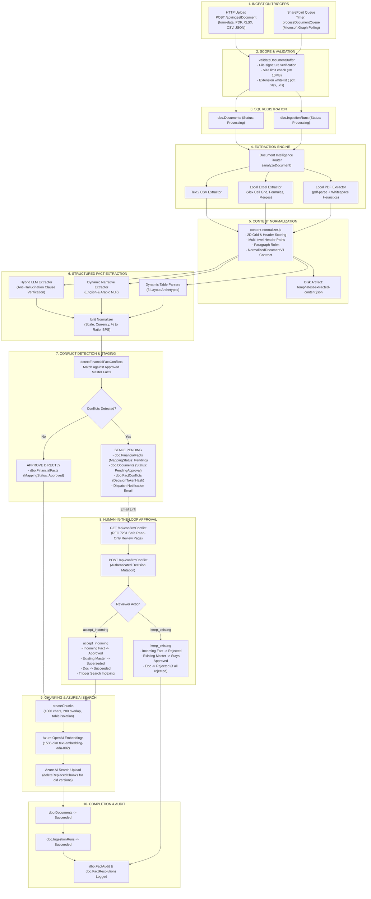
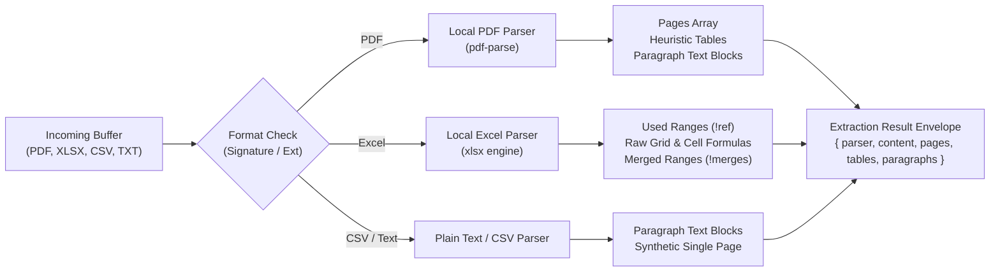
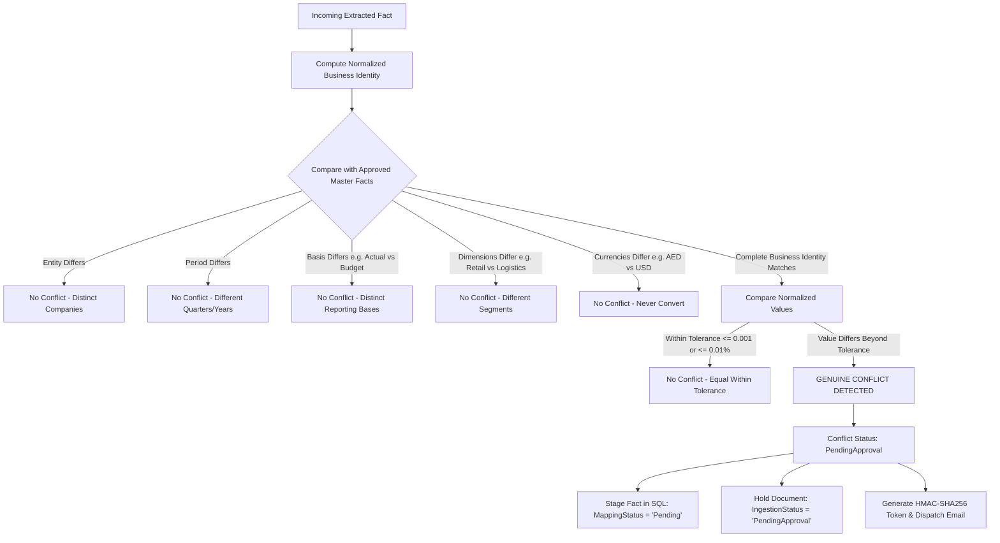
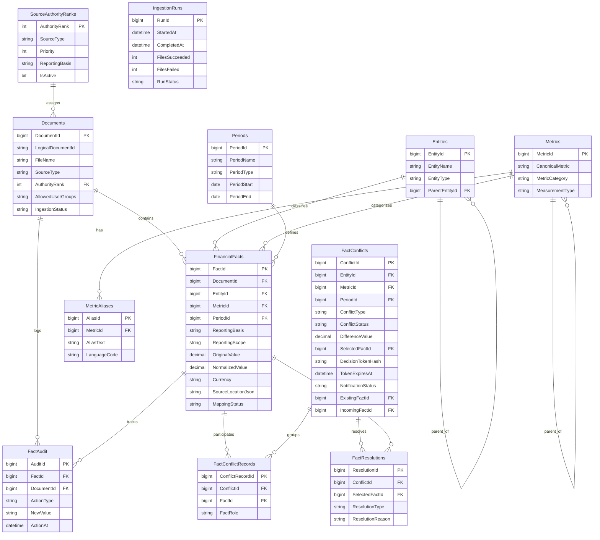

# Finora AI (FinChat) — Complete Ingestion, Extraction & System Architecture Workflow

## Table of Contents
1. [Executive Overview & System Objectives](#1-executive-overview--system-objectives)
2. [End-to-End System Architecture](#2-end-to-end-system-architecture)
3. [Data Ingestion Pathways (How Data Enters)](#3-data-ingestion-pathways-how-data-enters)
   - [Route A: HTTP REST API Ingestion (`POST /api/ingestDocument`)](#route-a-http-rest-api-ingestion-post-apiingestdocument)
   - [Route B: Scheduled SharePoint Queue Ingestion (`app.timer('processDocumentQueue')`)](#route-b-scheduled-sharepoint-queue-ingestion)
4. [Document Extraction Workflow (How Data Is Extracted)](#4-document-extraction-workflow-how-data-is-extracted)
   - [Local Extraction Engines (PDF, Excel, CSV, Plain Text)](#local-extraction-engines)
   - [Azure AI Document Intelligence (Cloud Layout Analysis)](#azure-ai-document-intelligence)
5. [Content Normalization & Contract Specifications](#5-content-normalization--contract-specifications)
   - [`NormalizedDocumentV1` Schema & 2D Grid Reconstruction](#normalizeddocumentv1-schema--2d-grid-reconstruction)
   - [Header Scoring, Hierarchy & Provenance Tracking](#header-scoring-hierarchy--provenance-tracking)
   - [Paragraph Role Classification](#paragraph-role-classification)
6. [Structured Financial Fact Extraction](#6-structured-financial-fact-extraction)
   - [Dynamic Entity, Metric, and Period Resolution](#dynamic-entity-metric-and-period-resolution)
   - [Table Layout Parsers (6 Structural Archetypes)](#table-layout-parsers-6-structural-archetypes)
   - [Dynamic Unit & Scale Normalization (`unit-normalizer.js`)](#dynamic-unit--scale-normalization)
   - [Dynamic Narrative Fact Extraction (English & Arabic NLP)](#dynamic-narrative-fact-extraction)
   - [Hybrid Extraction Architecture (Deterministic First + LLM Assisted)](#hybrid-extraction-architecture)
   - [`ExtractedFactsV1` Contract & Anti-Hallucination Controls](#extractedfactsv1-contract--anti-hallucination-controls)
7. [Post-Extraction Workflow & Human Conflict Governance](#7-post-extraction-workflow--human-conflict-governance)
   - [10-Step Ingestion Lifecycle & PendingApproval Hold](#10-step-ingestion-lifecycle--pendingapproval-hold)
   - [Dynamic Conflict Matching Algorithm (`conflict-resolver.js`)](#dynamic-conflict-matching-algorithm)
   - [Human Approval Workflow & Single-Use Decision Tokens](#human-approval-workflow--single-use-decision-tokens)
   - [State Transitions & Never Delete Historical Facts](#state-transitions--never-delete-historical-facts)
   - [Failure Rollback & Transaction Guarantees](#failure-rollback--transaction-guarantees)
8. [Database Schemas & Storage Implementations](#8-database-schemas--storage-implementations)
   - [Azure SQL Relational Database (13 Tables & Views)](#azure-sql-relational-database)
   - [Azure AI Search Hybrid Index Schema (`finance-hr-documents`)](#azure-ai-search-hybrid-index-schema)
9. [All Implemented Endpoints & Triggers (API Reference)](#9-all-implemented-endpoints--triggers-api-reference)
   - [`POST /api/ingestDocument`](#post-apiingestdocument)
   - [`GET /api/getIngestionStatus`](#get-apiingestionstatus)
   - [`GET /api/confirmConflict`](#get-apiconfirmconflict)
   - [`POST /api/confirmConflict`](#post-apiconfirmconflict)
   - [`POST /api/chat`](#post-apichat)
   - [`GET /api/dbHealth`](#get-apidbhealth)
   - [`Timer: processDocumentQueue`](#timer-processdocumentqueue)
10. [Recent Audits & Architectural Enhancements](#10-recent-audits--architectural-enhancements)
    - [Phase 4.3.4 & 4.3.5: Extraction Engine Defect Corrections](#phase-434--435-extraction-engine-defect-corrections)
    - [Phase 4.4 & 4.4.1: Conflict Governance & Security Hardening](#phase-44--441-conflict-governance--security-hardening)
    - [Phase 4.4.2: Final Verification & Live Cloud Integration](#phase-442-final-verification--live-cloud-integration)
11. [Test Suite Verification Status](#11-test-suite-verification-status)

---

## 1. Executive Overview & System Objectives

**Finora AI (FinChat)** is an enterprise financial and HR document intelligence platform built on Azure Functions v4 (Node.js). It integrates dynamic relational fact extraction in Azure SQL Database, hybrid vector and semantic search in Azure AI Search, and human-in-the-loop conflict governance.

### Core Problem Solved
Traditional document RAG architectures fail on financial data because:
1. **Financial figures cannot be approximated**: LLMs hallucinate numbers or confuse metrics across table rows and columns.
2. **Numbers lack atomic provenance**: Users cannot verify which exact cell, formula, table, or page a figure originated from.
3. **Contradictory source reports**: Working files, revised estimates, board packs, and audited statutory statements report differing figures for the same metric without clear governance.
4. **Calculations fail in text RAG**: Arithmetic (variances, YoY percentage changes, period reconciliations) cannot be left to probabilistic text generation.

### Solution Pillars
- **Dual-Engine Ingestion**: Ingests files on demand via HTTP REST API or automatically from corporate SharePoint document queues.
- **Relational Fact Extraction**: Extracts atomic facts into Azure SQL (`dbo.FinancialFacts`) with normalized values, units, currencies, reporting basis, temporal types, and cell-level provenance.
- **Human-in-the-Loop Conflict Governance (Phase 4.4, 4.4.1 & 4.4.2)**:
  - **Strictly No Auto-Resolution**: Source authority ranks are presented for context, but the engine **never** automatically picks a winner.
  - **Never Delete Historical Facts**: When an incoming fact is accepted, the existing master fact is retained in the database with `MappingStatus = 'Superseded'`, preserving complete audit lineage. If all facts in an older document become superseded, the document status transitions to `Superseded`.
  - **Single-Use Decision Tokens**: Expiring, HMAC-SHA256 signed decision tokens dispatched via email allow designated human reviewers to resolve discrepancies.
  - **Search Indexing Hold**: Documents with active conflicts are held in `PendingApproval` and **excluded from vector search indexing** until human review is completed.
  - **RFC 7231 Safe Read-Only GET**: Decision links opened by email crawlers (SafeLinks, Mimecast) render read-only review pages without mutating database state. Mutation requires authenticated `POST`.
- **Dual-Path Query Routing**: Qualitative/policy queries route to **Azure AI Search** (1536-dimensional multilingual vectors + BM25 keyword search); quantitative queries route to **Direct SQL Execution** coupled with a deterministic **Calculation Engine**.

---

## 2. End-to-End System Architecture



---

## 3. Data Ingestion Pathways (How Data Enters)

Data enters the system through two independent pathways:

```
+-----------------------------------------------------------------------------------------+
|                                  DATA INGESTION PATHWAYS                                |
+---------------------------------------------+-------------------------------------------+
| Route A: HTTP REST API                      | Route B: Scheduled SharePoint Queue       |
+---------------------------------------------+-------------------------------------------+
| Endpoint: POST /api/ingestDocument          | Function: Timer processDocumentQueue      |
| Invocations: Webhooks, UI uploads, scripts  | Schedule: NCRONTAB cron (e.g. */5 mins)   |
| Payloads: multipart, binary, CSV, JSON      | Source: SharePoint Online Document List   |
| Modes: Asynchronous (202) & Sync (200)      | Auth: Entra ID via ClientSecretCredential |
| Concurrency: Throttled background pool (3)  | Locking: Immediate 'Processing' lock      |
+---------------------------------------------+-------------------------------------------+
```

### Route A: HTTP REST API Ingestion (`POST /api/ingestDocument`)

#### Supported Input Content-Types
1. `multipart/form-data`: Single file or batch uploads in `file`, `document`, or `files` form fields. Form fields may also supply metadata overrides (`allowedUserGroups`, `authorityRank`, `sourceType`, `department`, `jobTitle`, `modifiedDate`).
2. `application/pdf`, `application/octet-stream`, `spreadsheetml`, `ms-excel`: Raw binary stream. Filename is extracted from `x-filename`, `content-disposition`, or query string `?filename=...`.
3. `text/plain`, `text/markdown`, `text/csv`: Raw text or CSV buffers.
4. `application/json`: JSON payload containing `{ "base64": "..." }` or `{ "text": "..." }` along with document metadata.

#### Parameters & Headers
- `authorityRank` (Query or `x-authority-rank`): Authority tier (1 to 4). Defaults to `4`.
- `sourceType` (Query or `x-source-type`): Source classification (e.g., `AuditedFinancials`, `BoardPacks`, `SharePoint`, `ManualUpload`).
- `allowedUserGroups` (Query or `x-user-groups`): Comma-separated ACLs (e.g., `finance-dept,executives`).
- `async` (Query `?async=false` or `x-async: false`): Setting to `false` forces synchronous execution. Default is `true`.

#### Asynchronous Processing Flow (Default)
1. **Synchronous Validation & Pre-Registration**: Validates buffers and inserts a placeholder record in `dbo.Documents` with status `Processing`.
2. **Run Initialization**: Creates a batch execution entry in `dbo.IngestionRuns`.
3. **HTTP 202 Response**: Immediately returns HTTP 202 Accepted with a `Location: /api/getIngestionStatus?documentId=<id>` header.
4. **Detached Worker Pool**: Spawns a background worker pool throttled to `CONCURRENCY_LIMIT = 3` parallel tasks using detached console logging (`createBackgroundLogger`) to prevent Azure Functions runtime termination errors.

---

### Route B: Scheduled SharePoint Queue Ingestion

Implemented in `src/functions/processDocumentQueue.js` and `src/services/sharepoint-queue.js`.

#### Polling & Lifecycle
1. **Trigger**: Scheduled Azure Functions Timer Trigger defined by `DOCUMENT_QUEUE_CRON` (e.g., `0 */5 * * * *`). Supports automatic conversion from 5-field standard cron to 6-field NCRONTAB.
2. **Authentication**: Authenticates as a service principal against Microsoft Entra ID using `ClientSecretCredential` with `https://graph.microsoft.com/.default` scope.
3. **Queue Query**: Queries the designated SharePoint Queue List (`SHAREPOINT_QUEUE_LIST`) for items with `fields/Status eq 'Pending'`.
4. **Concurrency Lock**: Immediately transitions the queue item status to `Processing` in SharePoint to prevent concurrent timer instances or auto-scaling nodes from processing the same file.
5. **Binary Download**: Retrieves binary file content from Microsoft Graph API `/drives/{driveId}/items/{driveItemId}/content`.
6. **Pipeline Execution**: Executes `processDocumentIngestion` with metadata extracted from SharePoint list columns (`DocumentKey`, `QueueKey`, `AuthorityRank`, `AllowedUserGroups`, `CreatedByDepartment`, `CreatedByJobTitle`, `ModifiedDate`).
7. **Status Finalization**: Updates the SharePoint list item to `Processed` (or `Failed` with the error reason).

---

## 4. Document Extraction Workflow (How Data Is Extracted)

The extraction phase is managed by `src/services/document-intelligence.js` and executed by `src/services/local-extractor.js`.



### Local Extraction Engines

#### 1. PDF Extraction (`extractFromPdf`)
- Uses `pdf-parse` to extract text streams while tracking page form-feed characters (`\f`).
- **Whitespace Heuristic Table Detection (`extractPossiblePdfTables`)**:
  - Scans consecutive lines for consistent tab-stop or multi-space delimiters ($\ge 2$ columns).
  - Groups candidate rows into structured table bounding boxes with `detectionConfidence: 0.45` and flags `requiresReview: true`.
- **Paragraph Segmentation**: Splits non-tabular page content along double newlines (`\n\s*\n`), preserving page coordinates.

#### 2. Excel Extraction (`extractFromExcel`)
- Uses `xlsx` to parse `.xlsx` and `.xls` files directly from memory buffers.
- **Full Range Preservation**: Reads `worksheet['!ref']` without assuming row 1 contains headers.
- **Cell-Level Metadata**: Extracts for every cell:
  - Coordinate address (`A1`, `B4`).
  - Raw value (`cell.v`), formatted display value (`cell.w`).
  - Formula string (`cell.f`).
  - Type indicator (`cell.t` — string, number, error, boolean).
- **Merged Cell Tracking**: Reads `worksheet['!merges']` and records bounding rectangles to propagate super-headers across merged columns.

#### 3. CSV & Plain Text Extraction (`extractFromTextOrCsv`)
- CSV streams are parsed into in-memory workbooks to ensure consistent tabular representations.
- Plain text documents are split into logical paragraphs mapped to page 1.

### Azure AI Document Intelligence
`src/services/document-intelligence.js` includes a pre-configured client for Azure Document Intelligence (Layout model `prebuilt-layout:analyze`). It is currently commented out in favor of the local extractor to eliminate third-party cloud costs and bypass tier page limits, but can be toggled on via environment variables if optical character recognition (OCR) on scanned documents is required.

---

## 5. Content Normalization & Contract Specifications

Raw extracted structures are converted into the strict **`NormalizedDocumentV1`** contract (`src/services/content-normalizer.js`), validated against `contracts/normalized-document.v1.schema.json`.

### `NormalizedDocumentV1` Schema & 2D Grid Reconstruction
Every document element is assigned an immutable `elementId` (`<documentId>_table_<index>` or `<documentId>_paragraph_<index>`).

```json
{
  "contractVersion": "NormalizedDocumentV1",
  "document": {
    "documentId": "doc_101",
    "fileName": "Q1_2026_Report.xlsx",
    "fileType": "xlsx",
    "metadata": {}
  },
  "elements": [
    {
      "elementId": "doc_101_table_1",
      "elementType": "table",
      "source": { "pageNumber": 1, "sheetName": "Income Statement" },
      "structure": { "rowCount": 12, "columnCount": 4, "headerRowIndex": 0 },
      "columns": [
        { "columnIndex": 0, "header": "Particulars", "headerPath": ["Particulars"], "dataTypeHint": "text" },
        { "columnIndex": 1, "header": "Q1 2026", "headerPath": ["Actual", "Q1 2026"], "dataTypeHint": "numeric" }
      ],
      "rows": [ ],
      "content": "| Particulars | Q1 2026 |\n| --- | --- |\n| Revenue | 15000000 |"
    }
  ]
}
```

### Header Scoring, Hierarchy & Provenance Tracking
- **Header Candidate Scoring (`scoreHeaderRow`)**:
  Calculates a composite score between 0.0 and 1.0 based on:
  $$\text{Score} = (\text{TextRatio} \times 0.50) + (\text{UniquenessRatio} \times 0.30) + (\text{FillRatio} \times 0.20)$$
- **Multi-Level Header Hierarchy**:
  When tables have stacked headers (e.g., Year row above Quarter row), contiguous text rows are scanned upward and downward. `buildHeaderPath` generates a hierarchical breadcrumb (e.g., `["2026", "Consolidated", "Q1"]`) and resolves horizontal merged cells.
- **Unique Header Disambiguation (`createUniqueHeaders`)**:
  Duplicate or blank headers are disambiguated by appending occurrence suffixes (e.g., `Revenue`, `Revenue__2`, `Column_3`).

### Paragraph Role Classification
`identifyParagraphRole` inspects textual semantics to tag narrative blocks:
- `title`: Document titles or report statements.
- `currency_declaration`: Statements declaring currency (e.g., *"Figures in AED"*).
- `approval`: Auditor sign-offs and executive approvals.
- `footnote`: Disclaimers and accounting notes (e.g., *"Note 1: Excludes discontinued ops"*).
- `commentary`: CFO commentary and management discussion.
- `table_row_duplicate`: Identifies text paragraphs that duplicate data from already extracted tables.
- `narrative`: Free-form narrative sentences containing embedded financial figures.

---

## 6. Structured Financial Fact Extraction

Managed by `src/services/fact-extraction.js` and validated against the **`ExtractedFactsV1`** contract.

### Dynamic Entity, Metric, and Period Resolution

#### Entity Resolution (Zero Hardcoded Companies)
Entities are resolved hierarchically without fixed corporate lists:
1. Explicit metadata (`issuer`, `reportingEntity`).
2. Document Title Delimiters (e.g., *"Contoso Logistics LLC - Financial Statements"* $\to$ `"Contoso Logistics LLC"`).
3. Corporate legal form designators (`LLC`, `Corp`, `Inc`, `Ltd`, `PLC`, `Holdings`, `Group`, `شركة`, `مؤسسة`).
4. Filename extraction.
5. If evidence is missing, returns `null` (never defaults to "Consolidated").

#### Metric & Period Typing
- **Temporal Typing**: Infers `instant` for point-in-time balance items (*as of*, *balance*, *headcount*, *closing*) and `duration` for flows over time (*revenue*, *expenses*, *profit*).
- **Preposition Separation (`cleanMetricLabel`)**: Strips trailing temporal phrases from metric labels (e.g., *"Revenue in Q2 2026"* is split into `metric = "Revenue"` and `periodLabel = "Q2 2026"`).

---

### Table Layout Parsers (6 Structural Archetypes)

The engine classifies each table into one of six layouts:

| Layout Archetype | Identification Condition | Extraction Behavior |
| :--- | :--- | :--- |
| **1. `entity_period_records`** | Columns for Entity AND Period present | Iterates rows; extracts metrics from remaining columns with specific entity and period coordinates. |
| **2. `entity_records`** | Entity column present, no Period column | Iterates rows; uses entity column value and maps remaining columns as metrics under document period. |
| **3. `time_series_matrix`** | Column 0 is Line Item; Columns 1..N contain dates/periods | Each row is a metric; each column represents a distinct period. Resolves row-level reporting basis. |
| **4. `metric_dimension_matrix`** | Column 0 is Metric; Columns 1..N are segments/channels | Maps row metric across column dimensions (e.g., `Retail`, `Wholesale`). |
| **5. `key_value_pairs`** | Exactly 2 columns (Label & Value) | Column 0 is metric label; Column 1 is value. Inspects row labels for reporting basis. |
| **6. `generic_tabular`** | Unmatched tabular formats | Fallback parser preserving grid positions and column headers. |

---

### Dynamic Unit & Scale Normalization

Implemented in `src/services/unit-normalizer.js`:
- **Scale Detection (`extractScaleFromText`)**: Detects explicit numeric scales (`Scale: 1000`), English scales (*thousands*, *millions*, *billions*), and Arabic scales (*بآلاف*, *بالملايين*, *مليار*).
- **Hierarchical Scale Application**: Resolves scale in order of priority: $\text{Column} > \text{Table} > \text{Document} > 1.0$.
- **Protection for Non-Monetary Figures**: Ratios, percentages, margins, and headcount metrics are shielded from scale multipliers.
- **Ratios & Basis Points**: Converts percentage values to decimal ratios ($15\% \to 0.15$) and basis points to decimal ratios ($50\text{ bps} \to 0.005$).
- **Accounting Negatives**: Parses parentheses format `(1,250.00)` into `-1250.00`.
- **Currency Detection**: Normalizes currency symbols (`$`, `€`, `£`, `₹`, `¥`) and ISO codes (`AED`, `USD`, `SAR`, etc.), including Arabic currency words (`دولار` $\to$ `USD`, `يورو` $\to$ `EUR`, `درهم` $\to$ `AED`, `ريال` $\to$ `SAR`).
- **Error Handling**: Gracefully handles formula errors (`#DIV/0!`, `#N/A`, `#VALUE!`), tagging them as `ValidationStatus: Invalid`.

---

### Dynamic Narrative Fact Extraction

Implemented in `extractNarrativeFinancialFacts`:
- Scans narrative sentences using 8 specialized bilingual regex patterns (Arabic and English achievement, stative, change, and announcement verbs).
- **Directional Polarity**: Contraction and decrease verbs (*decreased*, *fell*, *dropped*, *انخفضت*, *تراجعت*) are normalized to negative decimal values ($-0.05$).
- **Complete Business Identity Deduplication**: Compares facts across `Metric`, `NormalizedValue`, `Entity`, `Period`, `ReportingBasis`, `Unit`, and `Currency` to prevent dropping distinct entities that report identical figures.

---

### Hybrid Extraction Architecture

For ambiguous, complex, or unparsed narrative paragraphs, `extractFinancialFactsHybrid` integrates Azure OpenAI / Groq:
1. **Deterministic-First**: Runs high-speed deterministic extraction across all tables and standard narrative text.
2. **Selective Routing**: Identifies narrative paragraphs containing financial terms that did not yield deterministic facts.
3. **Strict Clause-Level Anti-Hallucination (`isMetricAssociatedWithValue`)**:
   - Segments paragraphs into grammatical clauses (`splitIntoClauses`).
   - Verifies that the LLM-extracted metric and number exist within the exact same clause.
   - Rejects misattributed cross-clause associations, incrementing `stats.hallucinationsRejected`.
4. **Graceful Fallback**: If the LLM client is unreachable or times out, the pipeline falls back to deterministic facts without disruption.

---

## 7. Post-Extraction Workflow & Human Conflict Governance

### 10-Step Ingestion Lifecycle & PendingApproval Hold

```
Step 1:  Validation & Scope Enforcement (.pdf, .xlsx, <= 10MB)
Step 2:  SQL Lifecycle Registration (dbo.Documents: Processing)
Step 3:  Document Extraction (Local PDF/Excel parsers)
Step 4:  Content Normalization (NormalizedDocumentV1 + temp JSON artifact)
Step 5:  Structured Fact Extraction (ExtractedFactsV1)
Step 6:  Fact Persistence & Dynamic Conflict Detection
         ├─ No Conflicts Detected ───────────────────────────────┐
         │  ├─ Insert dbo.FinancialFacts (Approved)             │
         │  ├─ Steps 7-9: Chunking, Embeddings, AI Search       │
         │  └─ Step 10: Complete (dbo.Documents: Succeeded)     │
         └─ Conflicts Detected (Phase 4.4 Governance)           │
            ├─ Stage dbo.FinancialFacts (MappingStatus: Pending)│
            ├─ Update dbo.Documents (Status: PendingApproval)   │
            ├─ Record dbo.FactConflicts (DecisionTokenHash)     │
            ├─ DEFER Steps 7-9 (Search Indexing Held)           │
            └─ Dispatch Notification Email with Decision Tokens  │
                                                                 │
[Human Decision via /api/confirmConflict] <──────────────────────┘
  ├─ keep_existing: Incoming -> Rejected, Doc -> Rejected (if all rejected)
  └─ accept_incoming: Incoming -> Approved, Master -> Superseded,
                      Doc -> Succeeded (or Superseded if older file fully superseded),
                      Trigger Steps 7-9 Search Indexing
```

---

### Dynamic Conflict Matching Algorithm (`conflict-resolver.js`)

When an incoming document is extracted in Step 6, its facts are compared against existing active approved facts retrieved via `getCompleteFinancialFacts()`:



#### Canonical Business Identity
A SHA-256 hash is computed across canonicalized identity tokens:
$$\text{keyString} = \text{metric} \mid \text{entity} \mid \text{period} \mid \text{basis} \mid \text{scope} \mid \text{unit} \mid \text{curr} \mid \text{dimensions}$$

- **Strictly No Auto-Resolution**: Source authority ranks are displayed on review screens for governance context, but the engine **never** auto-resolves conflicts or auto-promotes a fact.
- **Rounding Tolerance**: Absolute differences $\le 0.001$ or percentage differences $\le 0.01\%$ do not trigger conflicts.
- **Currency Isolation**: Figures in different currencies are never converted using assumed exchange rates.

---

### Human Approval Workflow & Single-Use Decision Tokens

Implemented across `src/services/conflict-token.js`, `src/services/conflict-notifier.js`, and `src/functions/confirmConflict.js`.

#### Token Cryptography & Lifecycle
1. **HMAC-SHA256 Signing**: Payload contains `{ conflictId, recipientEmail, nonce, exp, iat }` signed with `FINCHAT_CONFLICT_SECRET`.
2. **Database Hashing & Mandatory Match**: A SHA-256 hash of the token is saved in `dbo.FactConflicts.DecisionTokenHash`. When a decision request arrives, `hashToken(token)` must match the database hash. If stored hash is NULL or empty, the request is rejected with HTTP 401.
3. **Expiration**: Tokens expire after 72 hours by default (`TokenExpiresAt`). Expired tokens return HTTP 410 Gone.
4. **Replay Protection**: Once resolved, the conflict record transitions to `ConflictStatus = 'Resolved'`. Subsequent requests with the same token are rejected with HTTP 409 Conflict.
5. **Reviewer Authorization**: The email of the reviewer submitting the decision must match `NotificationRecipient`.
6. **Log Redaction (CWE-532)**: Tokens in request URLs are scrubbed in application logs (`sanitizeUrlForLogging`).
7. **Production Secret Guard**: In production (`NODE_ENV=production`, `AZURE_FUNCTIONS_ENVIRONMENT=production`, or Azure App Service), unconfigured secrets throw a fatal startup exception.

---

### State Transitions & Never Delete Historical Facts

When a human reviewer resolves a conflict via `POST /api/confirmConflict`:

```
+----------------------------------------------------------------------------------------------------+
|                                    DECISION STATE TRANSITIONS                                      |
+---------------------+-------------------------------+----------------------------------------------+
| Reviewer Action     | Incoming Candidate Fact       | Existing Master Fact                         |
+---------------------+-------------------------------+----------------------------------------------+
| keep_existing       | MappingStatus = 'Rejected'    | MappingStatus remains 'Approved'             |
| accept_incoming     | MappingStatus = 'Approved'    | MappingStatus = 'Superseded' (NEVER DELETED) |
+---------------------+-------------------------------+----------------------------------------------+
```

1. **`keep_existing`**:
   - Incoming candidate fact is marked `MappingStatus = 'Rejected'`.
   - Existing master fact remains `MappingStatus = 'Approved'`.
   - Conflict status is set to `ConflictStatus = 'Resolved'`.
   - If all incoming facts in the document are rejected, the document's `IngestionStatus` transitions to `'Rejected'`.
2. **`accept_incoming`**:
   - Incoming candidate fact is promoted to `MappingStatus = 'Approved'`.
   - Existing master fact is transitioned to `MappingStatus = 'Superseded'`. **Historical facts are never deleted**, maintaining full audit lineage.
   - If all approved facts in the older existing document have become superseded (`ApprovedCount === 0 && SupersededCount > 0`), the older document's `IngestionStatus` automatically transitions to `'Superseded'`.
   - Conflict status is set to `ConflictStatus = 'Resolved'`.
   - Incoming document `IngestionStatus` transitions to `'Succeeded'`.
   - **Post-Approval Search Indexing**: Chunks for the document are generated, embedded into 1536-dim vectors, and indexed into Azure AI Search!

---

### Failure Rollback & Transaction Guarantees
- All status transitions, fact promotions, and conflict resolutions execute inside strict SQL transactions (`BEGIN TRANSACTION`).
- If an unhandled error occurs during decision processing or ingestion, the transaction rolls back completely (`ROLLBACK TRANSACTION`), ensuring zero partial state.

---

## 8. Database Schemas & Storage Implementations

### Azure SQL Relational Database

Created and maintained via `database/schema.sql` and migrations `001_dynamic_financial_fact_architecture.sql` and `002_conflict_governance_and_notifications.sql`.



#### Detailed Table Definitions
1. **`dbo.SourceAuthorityRanks`**: Authority levels (1 to 4), priority ratings, and default reporting basis.
2. **`dbo.Entities`**: Dynamic registry of corporate entities, subsidiaries, and divisions.
3. **`dbo.Metrics`**: Canonical financial and HR metrics with standard measurement types.
4. **`dbo.MetricAliases`**: Multilingual aliases and synonyms mapping to canonical metrics.
5. **`dbo.Periods`**: Dynamic fiscal periods (quarters, full years, custom dates).
6. **`dbo.IngestionRuns`**: Batch telemetry tracking total files discovered, succeeded, and failed.
7. **`dbo.Documents`**: Document-level metadata, logical versioning, supersedes links, ACLs, and ingestion status (`Processing`, `PendingApproval`, `Succeeded`, `Rejected`, `PartiallyApproved`, `Superseded`, `Failed`).
8. **`dbo.FinancialFacts`**: Core atomic facts table (`OriginalValue`, `NormalizedValue`, `Currency`, `Unit`, `SourceLocationJson`, and `MappingStatus: Approved | Pending | Rejected | Superseded`).
9. **`dbo.FactConflicts`**: Discrepancy tracker recording value mismatches, percentage differences, `DecisionTokenHash`, `TokenExpiresAt`, `NotificationStatus`, `ExistingFactId`, and `IncomingFactId`.
10. **`dbo.FactConflictRecords`**: Many-to-many junction linking all facts participating in an N-way conflict.
11. **`dbo.FactResolutions`**: Immutable audit log of resolution decisions (`HumanDecisionKeepExisting`, `HumanDecisionAcceptIncoming`).
12. **`dbo.FactAudit`**: Fact-level event stream (extraction, status updates, value corrections).
13. **`dbo.AuthorityRank`**: SharePoint organizational role mapping table (JobTitle, Department to AuthorityRank).
14. **`dbo.vw_FinancialFacts_Complete`**: Reporting view that strictly enforces `WHERE (f.MappingStatus = 'Approved' OR f.MappingStatus IS NULL)`, ensuring unapproved facts (`Pending`, `Rejected`, `Superseded`) are completely isolated from chat retrieval and calculations.

---

### Azure AI Search Hybrid Index Schema

Targeted for index `finance-hr-documents` (script: `scripts/update-search-index.js`, service: `src/services/search-index.js`).

| Field Name | Type | Searchable | Filterable | Sortable | Facetable | Description |
| :--- | :--- | :---: | :---: | :---: | :---: | :--- |
| `id` | `Edm.String` | No | Yes | No | No | Unique chunk ID (`buildChunkId`). |
| `title` | `Edm.String` | Yes | Yes | Yes | No | Document title and section heading. |
| `content` | `Edm.String` | Yes | No | No | No | Full text of chunk or markdown table. |
| `source` | `Edm.String` | Yes | Yes | No | No | Source filename. |
| `contentVector` | `Collection(Edm.Single)` | Yes | No | No | No | 1536-dimensional vector embedding. |
| `chunkIndex` | `Edm.Int32` | No | Yes | Yes | No | Sequential chunk number within document. |
| `documentId` | `Edm.String` | No | Yes | No | No | SQL DocumentId foreign key. |
| `documentKey` | `Edm.String` | No | Yes | No | No | Stable file key (`driveId\|itemId`). |
| `queueKey` | `Edm.String` | No | Yes | No | No | Versioned key (`documentKey\|version`). |
| `fileName` | `Edm.String` | Yes | Yes | No | No | Searchable file name. |
| `fileLink` | `Edm.String` | No | No | No | No | SharePoint web URL. |
| `heading` | `Edm.String` | Yes | No | No | No | Section or table header. |
| `pageNumber` | `Edm.Int32` | No | Yes | No | No | Source page number. |
| `department` | `Edm.String` | Yes | Yes | No | No | Authoring department. |
| `jobTitle` | `Edm.String` | Yes | Yes | No | No | Author job title. |
| `authorityRank`| `Edm.Int32` | No | Yes | Yes | No | Document authority rank (1-4). |
| `modifiedDate` | `Edm.DateTimeOffset` | No | Yes | Yes | No | Last modification timestamp. |

---

## 9. All Implemented Endpoints & Triggers (API Reference)

### `POST /api/ingestDocument`
Uploads and ingests documents into the pipeline.
- **Methods**: `POST`
- **Auth Level**: `Anonymous`
- **Payload**: `multipart/form-data`, `application/pdf`, `application/octet-stream`, `text/csv`, `text/plain`, `application/json`
- **Responses**:
  - `202 Accepted` (Default): Returns `{ status: "Accepted", ingestionStatus: "Processing", documentId: 101, statusUrl: "..." }`
  - `200 OK` (when `?async=false`): Returns full synchronous ingestion result `{ status: "success", documentId: 101, factsExtracted: 24, chunksIndexed: 6 }`
  - `400 Bad Request`: Validation failure (unsupported extension, file $>10$ MB, corrupted PDF).

---

### `GET /api/getIngestionStatus`
Retrieves ingestion progress and fact extraction counts for a document.
- **Methods**: `GET`
- **Query Parameter**: `documentId=<id>` (numeric ID or filename string)
- **Response `200 OK`**:
  ```json
  {
    "documentId": 101,
    "fileName": "Audited_Financials_2026.pdf",
    "sourceType": "AuditedFinancials",
    "authorityRank": 1,
    "ingestionStatus": "Succeeded",
    "createdAt": "2026-11-15T12:00:00.000Z",
    "lastProcessedAt": "2026-11-15T12:00:14.000Z",
    "factsCount": 42,
    "correlationId": "status-1731672000"
  }
  ```

---

### `GET /api/confirmConflict`
Strictly read-only review endpoint conforming to RFC 7231 / RFC 9110 Safe Methods.
- **Methods**: `GET`
- **Query Parameters**: `token=<HMAC_token>`
- **Security**: Safe against automated corporate email scanners (Microsoft Defender SafeLinks, Mimecast) which prefetch email links. Never mutates database state.
- **Responses**:
  - `200 OK` (`Accept: text/html`): Renders responsive HTML decision page displaying existing vs. incoming figures, authority levels, and variance, containing a form that executes a `POST` decision.
  - `200 OK` (`Accept: application/json`): Returns `{ status: "PENDING_DECISION", conflictId: 101, message: "Submit POST to execute decision" }`.
  - `401 Unauthorized`: Forged, altered, or unmatching token hash.
  - `410 Gone`: Expired decision token (> 72 hours).

---

### `POST /api/confirmConflict`
Authenticated decision mutation endpoint.
- **Methods**: `POST`
- **Payload / Query**: `{ token: "<HMAC_token>", action: "keep_existing" | "accept_incoming" }`
- **Responses**:
  - `200 OK`: Conflict resolved. Returns `{ status: "SUCCESS", decision: "keep_existing", conflictId: 101 }`.
  - `400 Bad Request`: Missing token, missing action, or invalid action.
  - `401 Unauthorized`: Forged signature or hash mismatch.
  - `403 Forbidden`: Submitting user does not match authorized notification recipient.
  - `409 Conflict`: Conflict has already been resolved (replay attack prevention).
  - `410 Gone`: Expired token.

---

### `POST /api/chat`
Enterprise Question-Answering endpoint with dual-path query routing and conflict isolation.
- **Methods**: `POST`
- **Body**: `{ "question": "Compare Q1 vs Q2 revenue", "documentId": 101 }`
- **Headers**: `x-user-groups: finance-dept`, `x-job-id: job-123`
- **Conflict Governance Isolation**:
  - If target document has status `PendingApproval`, immediately returns `409 Conflict` with `status: 'PENDING_APPROVAL'`.
  - If target document has status `Rejected`, returns `status: 'REJECTED'`.
  - If target document has status `Superseded`, returns `status: 'SUPERSEDED'`.
  - If target document has status `PartiallyApproved`:
    - Questions regarding explicitly rejected figures return `status: 'REJECTED_FACT'`.
    - Questions regarding pending figures return `status: 'PENDING_FACT'`.
    - Questions asking about unapproved metrics strictly suppress narrative RAG fallback to prevent exposing unapproved figures.
  - Global Azure AI Search filter excludes all documents with status `PendingApproval`, `PendingReview`, `Pending`, `Rejected`, `Failed`, `Superseded`, or `PartiallyApproved`.
- **Processing**:
  1. `classifyIntent`: Uses LLM/rules to route question to `DIRECT_SQL` or `AZURE_SEARCH`.
  2. `DIRECT_SQL`: Queries `dbo.vw_FinancialFacts_Complete` (only approved facts) and feeds structured figures into `calculation-engine.js` (variances, YoY comparisons, reconciliation discrepancies).
  3. `AZURE_SEARCH`: Generates question embedding, performs hybrid vector + BM25 search in Azure AI Search with exclusion filters.
  4. `generateAnswer`: Synthesizes evidence-grounded answer citing exact source documents and pages.

---

### `GET /api/dbHealth`
Health check and database diagnostics endpoint.
- **Methods**: `GET`
- **Response `200 OK`**:
  ```json
  {
    "status": "healthy",
    "database": "finora-sql-db",
    "connected": true,
    "tablesFound": 13,
    "tables": ["AuthorityRank", "Documents", "Entities", "FactAudit", "FactConflictRecords", "FactConflicts", "FactResolutions", "FinancialFacts", "IngestionRuns", "MetricAliases", "Metrics", "Periods", "SourceAuthorityRanks"],
    "timestamp": "2026-11-15T12:00:00.000Z"
  }
  ```

---

### `Timer: processDocumentQueue`
Automated scheduled background worker.
- **Schedule**: Defined in `DOCUMENT_QUEUE_CRON` (NCRONTAB format).
- **Execution**: Connects to SharePoint via Microsoft Graph, retrieves pending files, executes `processDocumentIngestion`, and updates list statuses.

---

## 10. Recent Audits & Architectural Enhancements

### Phase 4.3.4 & 4.3.5: Extraction Engine Defect Corrections
1. **Defect 1 — Metric-Value Association & Hallucination Defense**: Replaced paragraph string searches with `splitIntoClauses` and `isMetricAssociatedWithValue`.
2. **Defect 2 — Multi-Entity Narrative Deduplication**: Upgraded narrative deduplication to verify full business identity (`Metric` + `Value` + `Entity` + `Period` + `ReportingBasis`).
3. **Defect 3 — Negative Delta Polarity Normalization**: Normalized contraction/decrease verbs to negative decimal values ($-0.05$).
4. **Defect 4 — Arabic Currency Detection (`دولار` & `يورو`)**: Added full Unicode support for Arabic currency names (`دولار` $\to$ `USD`, `يورو` $\to$ `EUR`).
5. **Defect 5 — Row-Level Reporting Basis**: Implemented `resolveRowReportingBasis` across key-value tables and narrative sentences.
6. **Defect 6 — Temporal Preposition Separation**: Strips prepositional phrases (*in Q2 2026*) from metric names and maps them to `periodLabel`.
7. **Defect 7 — Arabic Metric Language Contamination**: Guarded Arabic percentage extraction against appending English `" growth"`.
8. **Defect 8 — Source Filename Provenance**: Attached `sourceFileName` to every emitted fact object across all extraction paths.

### Phase 4.4 & 4.4.1: Conflict Governance & Security Hardening
1. **RFC 7231 Safe Methods**: Guaranteed that HTTP `GET /api/confirmConflict` is strictly read-only, rendering an HTML review page without state mutation. Mutation strictly requires authenticated `POST`.
2. **Database Token Hashing**: Added `DecisionTokenHash` to `dbo.FactConflicts`. Every decision request validates that `hashToken(token)` matches the active record.
3. **Log Token Redaction (CWE-532)**: Scrubbed secret decision tokens from application URLs and diagnostic traces (`token=[REDACTED]`).
4. **Production Secret Enforcement**: Rejection of default fallback secrets when deployed in Azure or production environments.
5. **Document Ingestion Status Integrity**: If all incoming facts in a document are rejected by human review, document status transitions to `Rejected` (never `Succeeded`).
6. **PartiallyApproved Document Narrative Guard**: Queries on `PartiallyApproved` documents asking about unapproved metrics strictly suppress narrative RAG fallback.

### Phase 4.4.2: Final Verification & Live Cloud Integration
1. **Mandatory Token Hash Check**: Confirmed that `confirmConflict.js` and `sql.js` reject decisions if `DecisionTokenHash` is missing or null.
2. **Superseded Document Transition**: When incoming approval supersedes an existing master fact, the system checks if all facts in the older document have become superseded; if so, the older document status transitions to `Superseded`.
3. **Targeted Status Guard for Superseded Documents**: Added explicit handling in `chat.js` for `targetDoc.IngestionStatus === 'Superseded'`, returning `status: 'SUPERSEDED'`.
4. **Actual Azure Cloud Probes**:
   - **Azure AI Search (`finchat-search.search.windows.net`)**: Verified live with HTTP 200, successfully executing hybrid vector search and confirming exclusion filter enforcement.
   - **Azure SQL Database (`finchat-dbserver.database.windows.net`)**: Reached port 1433 and verified live firewall gateway gating.

---

## 11. Test Suite Verification Status

The complete workspace passes 100% of unit, regression, and audit test suites:
- **Build Verification**: All 32 JavaScript source files in `src/` pass `node --check`.
- **Total Unit Tests**: **213 tests passed / 213 total (100% pass rate, 0 failures)** across 19 test suites:
  - Benchmark 11 Financial Documents Verification: 7/7 passed.
  - Contract & Schema Validation (`NormalizedDocumentV1`, `ExtractedFactsV1`): 10/10 passed.
  - Phase 4.3.4 Comprehensive Extraction Audit: 15/15 passed.
  - Phase 4.3.5 Defect Corrections: 16/16 passed.
  - Phase 4.4 Conflict Detection & Workflow: 22/22 passed.
  - Phase 4.4.1 & 4.4.2 Security & Integration Audit: 24/24 passed.
  - Golden Dataset Strict Evaluation (v2): **100/100 True Positives, 0 False Positives, 0 False Negatives (100% Precision, Recall, and F1)**.
